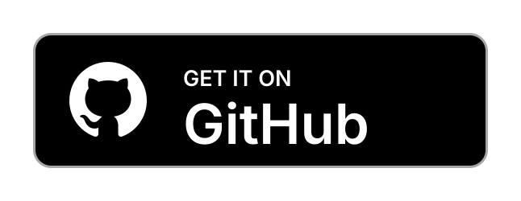

<picture>
  <source media="(prefers-reduced-motion: reduce)" srcset="docs/readme/hero-static.png">
  
</picture>

### Less scrolling. More studying.

FocusForge helps you block distractions, build a study routine, and keep track of the effort that turns into progress.

  
  

**Free & open source** · No ads · No subscriptions

Version 1.0.4 · Android 7.0+ · MIT licensed

 

### A quieter space to do your best work.

  
  

<picture>
  <source media="(prefers-color-scheme: dark)" srcset="docs/screenshots/gallery-dark.png">
  <source media="(prefers-color-scheme: light)" srcset="docs/screenshots/gallery-day.png">
  
</picture>

A theme-aware preview. Choose Day or Dark to open either gallery.

 
Dark is a device capture of the 1.0.4 build; Day is a widget render with demo data. Both sit in illustrative phone frames. <a href="docs/screenshots/README.md">How the screenshots were made</a>.

## Close the feed. Keep the lecture.

| Protect your attention | Find your rhythm | See your effort add up |
| :--- | :--- | :--- |
| Block distracting apps, set daily budgets, or activate Shield during focus. Filter YouTube Shorts and feeds while keeping lecture links available. | Start a Pomodoro, create and name your own plan, choose a subject, and mix ambient sounds. Settle into a full-screen clock. | Follow daily goals, subject totals, study trends and streaks. Earn XP, levels and badges as you build your routine. |

**A pause before the scroll.** Guided 4–7–8 breathing gives you room to decide before opening a shielded app. Strict Mode adds a deliberate cooldown before ending your commitment.

**A clock that feels like yours.** Choose your clock face and palette, switch between Day and Dark, or use AMOLED black. Bring your progress to your home screen with **Retro clock**, **Study session**, **Daily goal**, and **Weekly progress** widgets that follow your theme. Running timers also use an ongoing Android countdown notification.

**A little company goes a long way.** Create or join a private study group with an invite code, work toward a shared weekly goal, and see who is focusing.

## Made for your device.

FocusForge follows your phone’s language with support for 25 languages. Tablets get a floating side navigation rail and roomier study layouts; phones keep their familiar bottom navigation.

## Pick up where you left off.

Linked accounts privately back up your subjects, custom plans, goals, completed focus sessions, profile and earned achievements. Sign in again to recover the data that finished syncing. An app update keeps your existing login and reconciles saved study data in the background.

The timer also works without an account. Optional study groups and the weekly leaderboard share limited summaries when you choose them. Leaderboard sharing stays on after sign-out until you turn it off or delete your account. You can delete your account in the app or on the [website](https://focusforgeorg.vercel.app/delete-account).

<strong>Permissions, cloud backup & device support</strong>

- **Shield:** Usage Access detects selected apps and measures time budgets; Draw over other apps displays the pause screen. Optional Accessibility is used only for supported YouTube Shorts and feed filters. App boundaries run with a visible notification and Stop action. Each feature explains its access before you enable it.
- **Notifications:** Allow notifications to show the running countdown outside the app. Android 16 Live Updates and compatible device bars or islands depend on the device software, permissions, and user settings; presentation is not guaranteed on every phone.
- **Widgets:** Add them from your launcher's Widgets menu. Refresh behavior can vary with launcher and battery settings.
- **Private backup:** Offline changes stay local until syncing succeeds. A fresh installation can recover the study setup, completed sessions and achievements that reached the linked account. Screen-time, app-usage history and Shield activity stay on your device. See [Firebase setup](docs/firebase-setup.md).
- **Account controls:** Sign out keeps your account and private backups. Delete account confirms your identity, removes associated cloud records and then your login. In-app deletion also clears this device’s progress; website deletion cannot erase phone-local history. Failed cleanup can be retried. See [account deletion](https://focusforgeorg.vercel.app/delete-account).

## Your next focused session starts here.

1. **[Get on Play Store](https://focusforgeorg.vercel.app/get-on-play)** by following the closed-test steps, or **[get the APK on GitHub](https://github.com/MufasaXz/focusforge/releases/latest)**.
2. **Choose your subjects and a daily goal.** Continue without an account, or link one for private study backup and optional shared features.
3. **Start your clock.** Enable the permissions for Shield when you want to block distractions.

Want to help bring FocusForge to Google Play? We’re looking for **50+ testers**. [Join the closed test](https://focusforgeorg.vercel.app/get-on-play), stay opted in and keep the app installed for 14 consecutive days, use it for 1–5 minutes daily, and share honest feedback.

Need help installing an APK? Follow the [installation guide](docs/play-protect.md).

---

**Make room for what matters.**

[Release notes](CHANGELOG.md) · [Report an issue](https://github.com/MufasaXz/focusforge/issues) · [Firebase setup](docs/firebase-setup.md) · [Security notes](docs/security-audit-2026-10-12.md) · [MIT license](LICENSE)

