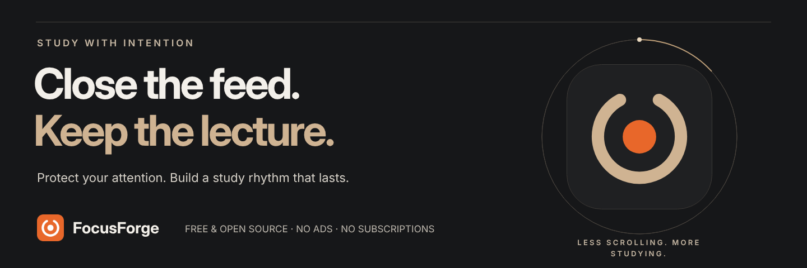
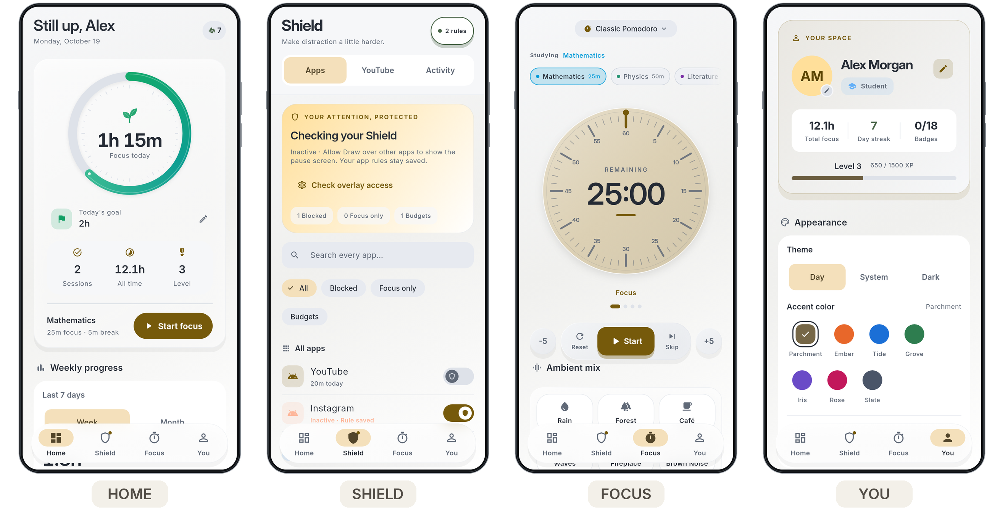

<picture>
  <source media="(prefers-reduced-motion: reduce)" srcset="docs/readme/hero-static.png">
  
</picture>

### Less scrolling. More studying.

FocusForge helps you block distractions, build a study routine, and keep track of the effort that turns into progress.

  
  

**Free & open source** · No ads · No subscriptions

Version 1.0.3 · Build 2019 · Android 7.0+ · MIT licensed

 

### A quieter space to do your best work.

  
  

<picture>
  <source media="(prefers-color-scheme: dark)" srcset="docs/screenshots/gallery-dark.png">
  <source media="(prefers-color-scheme: light)" srcset="docs/screenshots/gallery-day.png">
  
</picture>

A theme-aware preview. Choose Day or Dark to open either gallery.

 
Current app renders with fictional demo data in illustrative phone frames. <a href="docs/screenshots/README.md">How the screenshots were made</a>.

## Close the feed. Keep the lecture.

| Protect your attention | Find your rhythm | See your effort add up |
| :--- | :--- | :--- |
| Block distracting apps, set daily budgets, or activate Shield during focus. Filter YouTube Shorts and feeds while keeping lecture links available. | Start a Pomodoro, create and name your own plan, choose a subject, and mix ambient sounds. Settle into a full-screen clock. | Follow daily goals, subject totals, study trends and streaks. Earn XP, levels and badges as you build your routine. |

**A pause before the scroll.** Guided 4–7–8 breathing gives you room to decide before opening a shielded app. Strict Mode adds a deliberate cooldown before ending your commitment.

**A clock that feels like yours.** Choose your clock face and palette, switch between Day and Dark, or use AMOLED black. Bring your progress to your home screen with **Retro clock**, **Study session**, **Daily goal**, and **Weekly progress** widgets that follow your theme. Running timers also use an ongoing Android countdown notification.

**A little company goes a long way.** Create or join a private study group with an invite code, work toward a shared weekly goal, and see who is focusing.

## Pick up where you left off.

Returning accounts keep their saved setup on the same installation, and unfinished setup resumes at the saved step for that account. Earned badge IDs and dates can also back up privately to your linked account, ready to restore when you sign in again—even months later. The Achievements screen shows your next milestone and whether the backup is saved, syncing, or waiting for a connection.

The timer works without an account. Detailed study history and setup stay on your device; the account backup covers earned achievements. Groups and the optional leaderboard share limited summaries when you choose those features. You can delete your account from the app.

<strong>Permissions, cloud backup & device support</strong>

- **Shield:** Android Accessibility is used to detect and interrupt blocked apps and distracting feeds, and to display the breathing overlay. Usage Access supports app time budgets. The app explains the permissions needed for each feature.
- **Notifications:** Allow notifications to show the running countdown outside the app. Android 16 Live Updates and compatible device bars or islands depend on the device software, permissions, and user settings; presentation is not guaranteed on every phone.
- **Widgets:** Add them from your launcher's Widgets menu. Refresh behavior can vary with launcher and battery settings.
- **Achievement restore:** The revised Firebase rules must be published to enable the private backup. Offline unlocks stay local until they sync. A fresh installation can restore achievements that reached the account backup. See [Firebase setup](docs/firebase-setup.md).
- **Account controls:** Sign out keeps your setup, local history and private badge backup. Delete account verifies your password or Google account, removes cloud records and then your login, and clears this device’s progress. The client flow works on Firebase Spark after the one-time [rules, indexes and migration setup](docs/firebase-setup.md). External requests remain available on the website.

## Your next focused session starts here.

1. **[Download the Android APK](https://github.com/MufasaXz/focusforge/releases/download/1.0.3/focusforge-1.0.3.apk)** from the 1.0.3 release and install it.
2. **Choose your subjects and a daily goal.** Continue without an account, or link one for shared features and achievement backup.
3. **Start your clock.** Enable the permissions for Shield when you want to block distractions.

Need help installing? Follow the [installation guide](docs/play-protect.md).

---

**Make room for what matters.**

[Release notes](CHANGELOG.md) · [Report an issue](https://github.com/MufasaXz/focusforge/issues) · [Firebase setup](docs/firebase-setup.md) · [Security notes](docs/security-audit-2026-10-12.md) · [MIT license](LICENSE)

