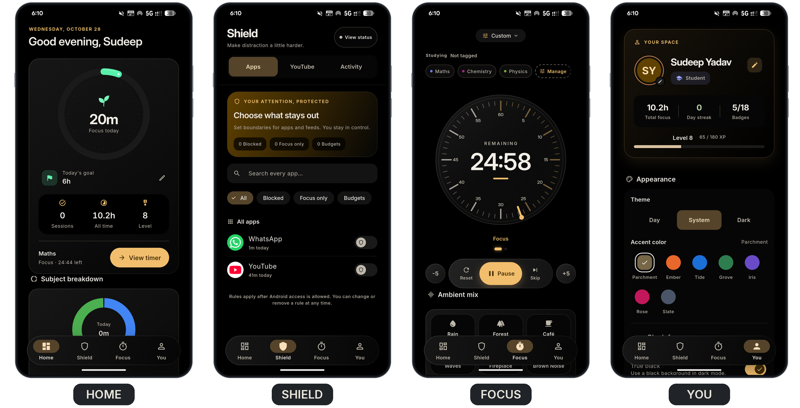
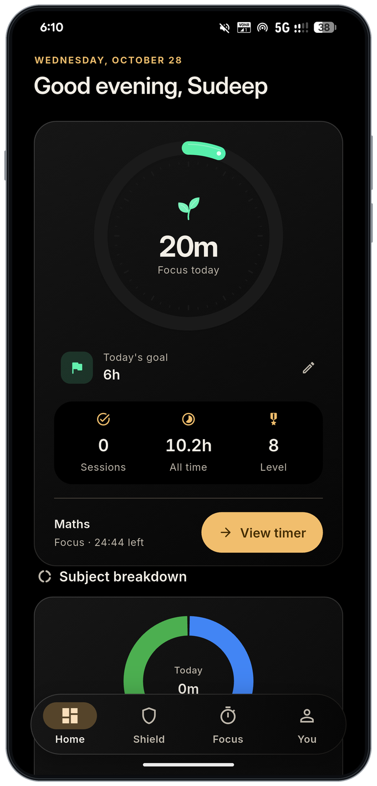
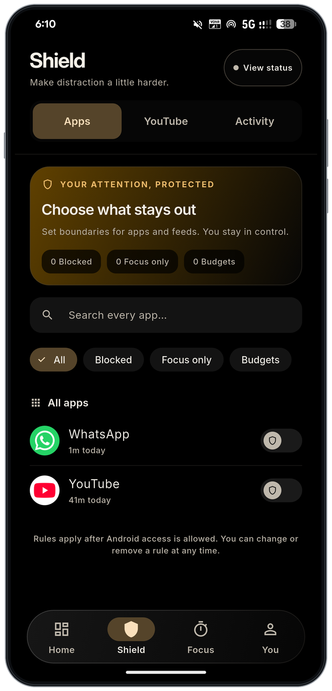
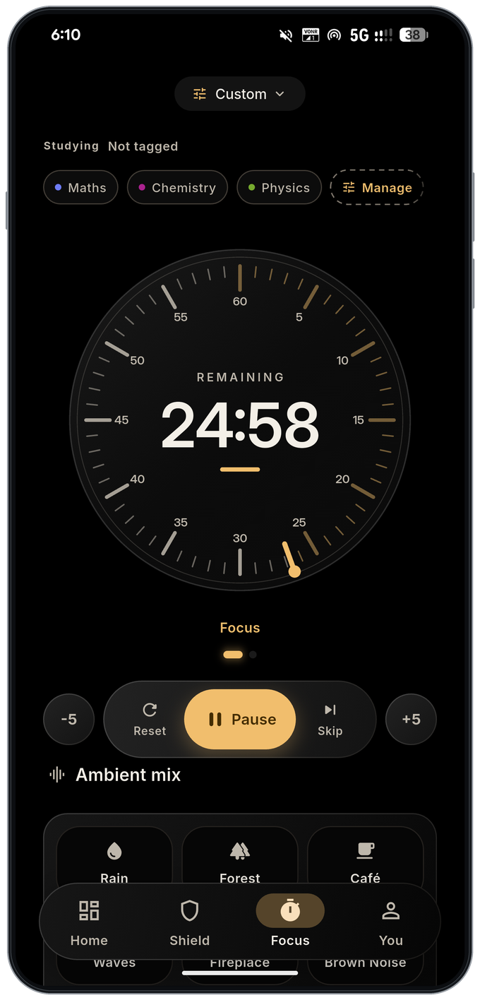
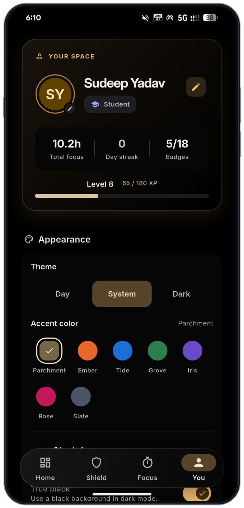
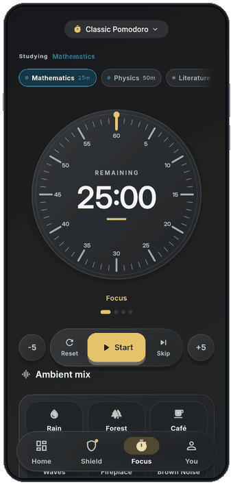

# FocusForge · Dark

A quiet workspace for late-night study.

  
  

Version 1.0.4 · Build 2029 · Captured on a physical device from the maintainer's own account.

## Take a closer look

Select a screen to open its original app render.

  
  

<strong>Home</strong> · Your daily direction &nbsp; / &nbsp; <strong>Shield</strong> · Room to concentrate

  
  

<strong>Focus</strong> · One session at a time &nbsp; / &nbsp; <strong>You</strong> · Make it yours

<strong>See the Focus control in motion</strong>

This is the app's real Start transition captured from Flutter, and it remains a widget render rather than a device capture. The countdown is not sped up.

These four are physical-device captures of the 1.0.4 build, taken from the maintainer's own account and published deliberately, so the name and the totals on them are real. Only the phone border and the rounded screen clipping are added. [Screenshot provenance and reproduction](README.md).

[← Back to FocusForge](../../README.md) · [Explore Day](day.md)
