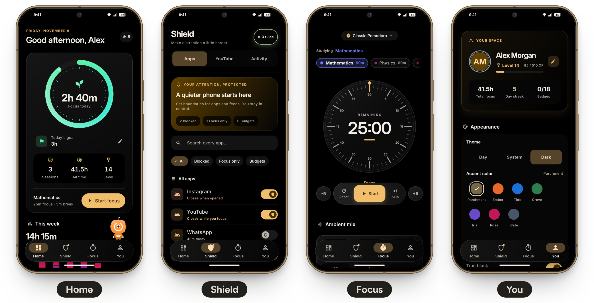
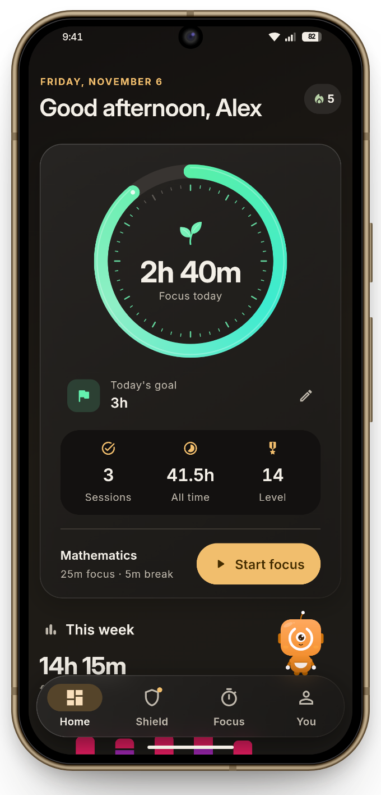
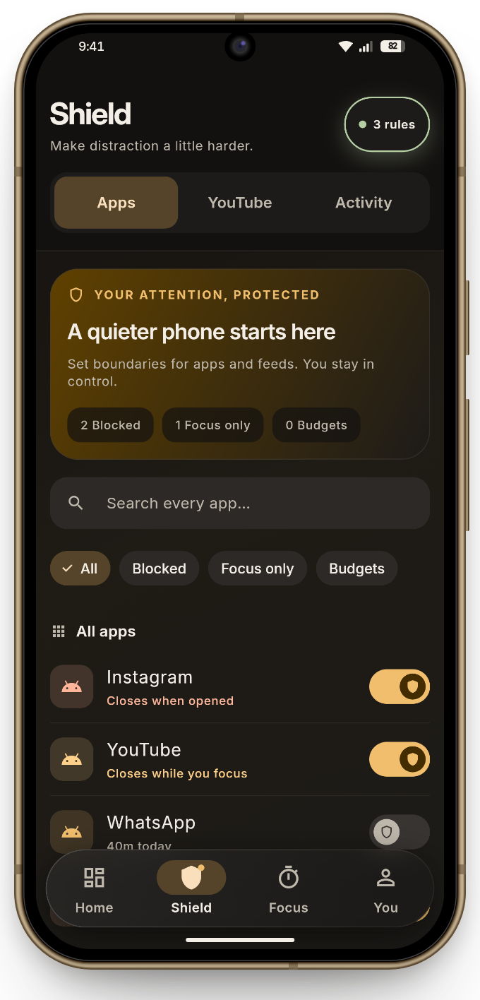
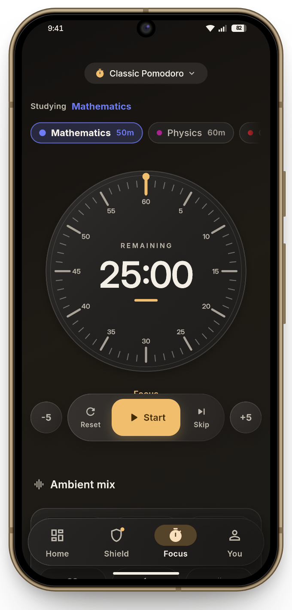
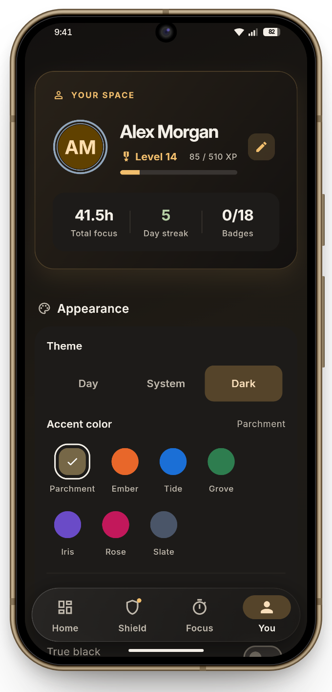
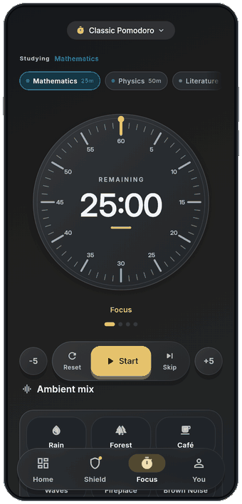

# FocusForge · Dark

A quiet workspace for late-night study.

  
  

Version 1.0.6 · Flutter widget render with demo data, in the website's phone frame.

## Take a closer look

Select a screen to open its original app render.

  
  

<strong>Home</strong> · Your daily direction &nbsp; / &nbsp; <strong>Shield</strong> · Room to concentrate

  
  

<strong>Focus</strong> · One session at a time &nbsp; / &nbsp; <strong>You</strong> · Make it yours

<strong>See the Focus control in motion</strong>

This is the app's real Start transition captured from Flutter, and it remains a widget render rather than a device capture. The countdown is not sped up.

These four are Flutter widget renders with demo data: Alex Morgan, the study totals and the app list are made up for the screenshots. They sit in the same phone frame as the website. [Screenshot provenance and reproduction](README.md).

[← Back to FocusForge](../../README.md) · [Explore Day](day.md)
