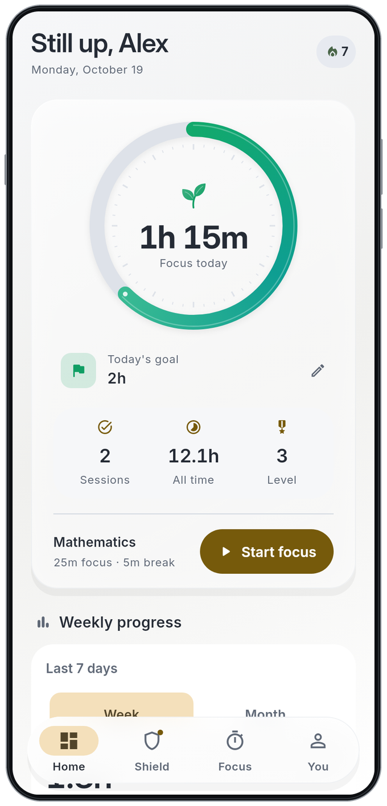
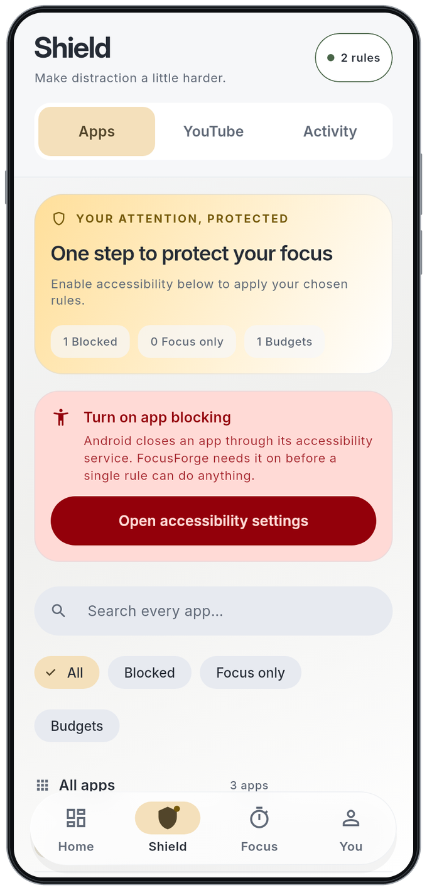
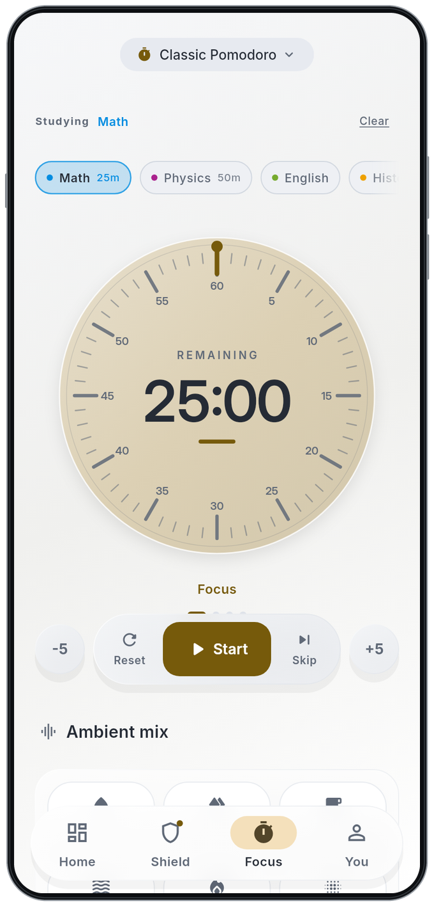
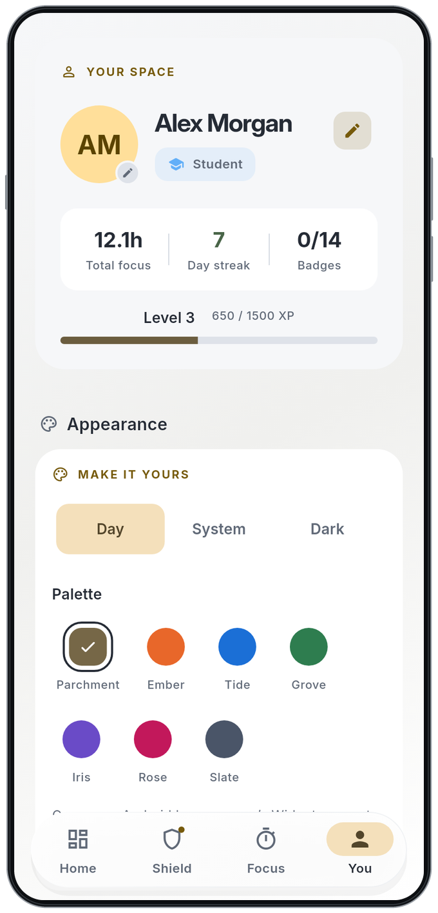

# FocusForge · Day

A light workspace for your next focused session.

  
  

Version 1.0.3 · Build 2019 · Flutter widget render with fictional demo data.

## Take a closer look

Select a screen to open its original app render.

  
  

<strong>Home</strong> · Your daily direction &nbsp; / &nbsp; <strong>Shield</strong> · Room to concentrate

  
  

<strong>Focus</strong> · One session at a time &nbsp; / &nbsp; <strong>You</strong> · Make it yours

The screenshots use real app widgets, bundled fonts, and fictional local fixtures. Phone borders are illustrative; these are not physical-device captures. [Screenshot provenance and reproduction](README.md).

[← Back to FocusForge](../../README.md) · [Explore Dark](dark.md)
